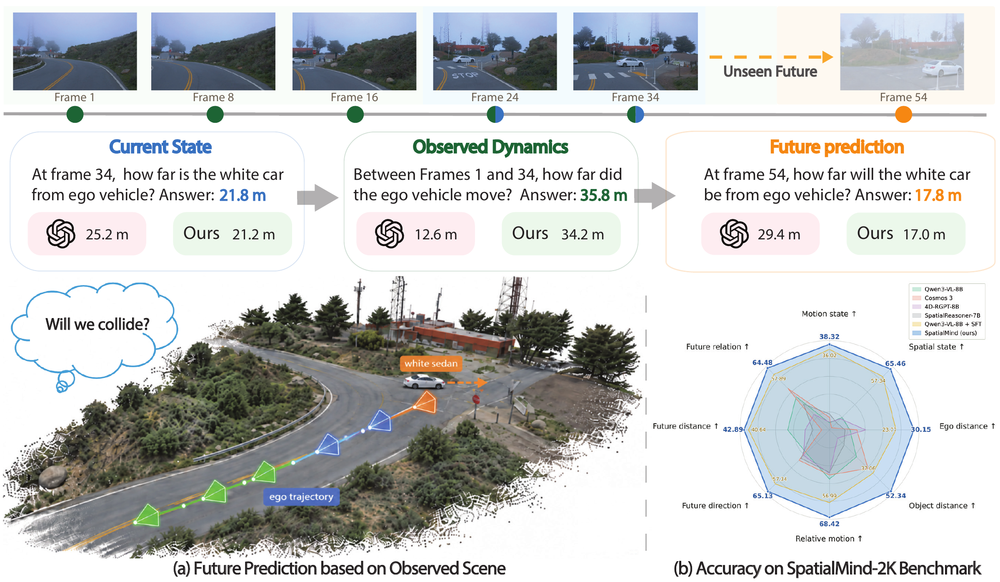

<div align="center">

<h1>SpatialMind</h1>
<h2>From Sight to Foresight:<br>Predictive Spatial Reasoning in Vision-Language Models</h2>

<p>If you find this repository useful, please give us a star 🌟</p>

<p>
  <a href="https://arxiv.org/pdf/2610.04139"></a>
  <a href="https://brack-wang.github.io/spatialmind/"></a>
</p>

[Feiran Wang](https://brack-wang.github.io/)<sup>1,†</sup>,
[Xiaoqi Wang](https://scholar.google.com/citations?user=i__pLDEAAAAJ&hl=en)<sup>2,‡</sup>,
[Ziwei Li](https://sites.google.com/view/ziwei-li/home?pli=1&authuser=0)<sup>2</sup>,
[Wenbin He](https://hewenbin.github.io/)<sup>2</sup>,
[Yan Yan](https://tomyan555.github.io/)<sup>1</sup>,
[Liu Ren](https://www.liu-ren.com/)<sup>2</sup>

<sup>1</sup> University of Illinois at Chicago &nbsp;&nbsp; <sup>2</sup> Bosch

<sup>†</sup> This work was done during an internship at Bosch. &nbsp;&nbsp; <sup>‡</sup> Project lead.

</div>

## Overview

Official repository for **SpatialMind**, a vision-language model for spatial reasoning and future prediction at real-world scale. Given an observed video, SpatialMind reasons about distances, motion, and spatial relations, and predicts how they will evolve beyond the observed interval.



- **Metric grounding:** A metric depth adapter and spatiotemporal fusion integrate geometry and camera motion into visual representations.
- **Progressive reasoning:** A progressive state chain connects current-state understanding, observed dynamics, and future prediction. Future frames are withheld from model inputs.
- **Data and benchmark:** SpatialMind-30K contains **30,677 training QA pairs**, and SpatialMind-2K provides **2,000 evaluation questions** across eight tasks spanning driving and everyday egocentric scenes.

SpatialMind achieves an **overall score of 52.65%** on SpatialMind-2K, compared with **45.70%** for Qwen3-VL-8B fine-tuned on the same training data, and shows competitive zero-shot performance on VSI-Bench, OSI-Bench, and VLM4D. See the [paper](https://arxiv.org/abs/2610.04139) for full results.

## Release Status

The [paper](https://arxiv.org/abs/2610.04139) and [project page](https://brack-wang.github.io/spatialmind/) are available. **Code and data are coming soon.**

## Citation

If you use SpatialMind in your research, please cite:

```bibtex
@misc{wang2026spatialmind,
  title         = {From Sight to Foresight: Predictive Spatial Reasoning in Vision-Language Models},
  author        = {Feiran Wang and Xiaoqi Wang and Ziwei Li and Wenbin He and Yan Yan and Liu Ren},
  year          = {2026},
  eprint        = {2610.04139},
  archivePrefix = {arXiv},
  primaryClass  = {cs.CV},
  url           = {https://arxiv.org/abs/2610.04139}
}
```
